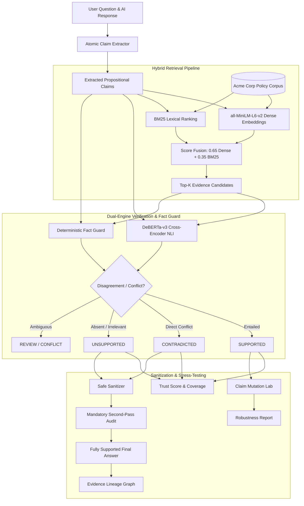

# GroundCheck

> **Evidence-First AI Verification, Observability & Verifier Stress-Testing**

[](https://www.python.org/)
[](https://fastapi.tiangolo.com/)
[](https://react.dev/)
[](https://www.typescriptlang.org/)
[](https://tailwindcss.com/)
[](https://pytest.org/)

---

## 1. Product Thesis

> **GroundCheck doesn't just audit an AI answer. It tests whether its own verifier can detect controlled factual modifications to numbers, dates, scope, and negation.**

Most RAG reliability tools only inspect whether an answer looks supported at runtime. A verifier that marks a generated answer as valid, but also accepts "20 paid leave days" when the corporate policy strictly says "14 days," is fundamentally untrustworthy.

GroundCheck introduces an auditable, evidence-first AI reliability console featuring:
1. **Atomic Claim Extraction:** Conservative sentence & proposition segmentation preserving numbers, units, qualifiers, scope, and negation.
2. **Hybrid Evidence Retrieval:** Dense semantic embeddings (`all-MiniLM-L6-v2`) fused with lexical BM25 ranking (0.65 dense + 0.35 lexical).
3. **NLI Verification & Fact Guarding:** Cross-encoder inference (`nli-deberta-v3-base`) paired with a deterministic numerical & policy fact guard to catch subtle contradictions and prevent hallucinations.
4. **Safe Sanitization with Independent Second-Pass Audit:** Eliminates unsupported statements, applies canonical source corrections, and mandates an independent re-audit before approving answers.
5. **Claim Mutation Lab (Core Differentiator):** Stress-tests the verifier itself using 5 deterministic mutation families with source-grounded expected outcomes and separate robustness metrics.
6. **Navigable Evidence Lineage:** Structured provenance graphs tracing `Claim → Evidence Chunk → Source Document → Verdict → Sanitization Action → Final Re-Verified Claim`.

---

## 2. Architecture & Decision Flow



---

## 3. Technology Stack

### Frontend
- **Framework:** React 19 + Vite + TypeScript
- **Styling:** Tailwind CSS (Dark ink/navy sidebar `#070b14`, slate content canvas `#f8fafc`, restrained indigo/cyan accents)
- **Icons:** Lucide React
- **API Client:** Fully typed client with structured error handling

### Backend
- **Framework:** Python 3.11+, FastAPI, Pydantic v2
- **Server:** Uvicorn (ASGI)
- **Mathematical & Retrieval:** NumPy, `rank-bm25`
- **Embedding Model:** `sentence-transformers/all-MiniLM-L6-v2` (CPU-compatible)
- **NLI Model:** `cross-encoder/nli-deberta-v3-base` (CPU-compatible)
- **Testing:** `pytest`, `fastapi.testclient`, `httpx`

*No GPU or paid LLM API keys are required.*

---

## 4. Directory Structure

```
GroundCheck/
├── backend/
│   ├── app/
│   │   ├── api/
│   │   │   └── endpoints.py          # FastAPI routes: /verify, /sanitize, /mutation-tests, etc.
│   │   ├── data/
│   │   │   └── acme_corpus.json       # Acme Corp HR, IT, and Remote Work policies
│   │   ├── engine/
│   │   │   ├── claim_extractor.py     # Sentence & coordinate proposition segmentation
│   │   │   ├── chunker.py             # Paragraph & sentence chunking utilities
│   │   │   ├── document_loader.py     # Corpus loader, indexing, and citation tracking
│   │   │   ├── embeddings.py          # Thread-safe MiniLM embedding singleton
│   │   │   ├── fact_guard.py          # Deterministic numerical and policy constraint checker
│   │   │   ├── history_manager.py     # Bounded in-memory session audit storage
│   │   │   ├── lineage.py             # Structured evidence lineage graph generator
│   │   │   ├── mutation_generator.py  # Controlled variant generator and robustness suite
│   │   │   ├── nli_verifier.py        # DeBERTa-v3 cross-encoder inference & decision fusion
│   │   │   ├── retrieval.py           # Hybrid dense + BM25 retriever
│   │   │   ├── sanitizer.py           # Safe sanitization engine (remove_unsafe / canonical)
│   │   │   └── scoring.py             # PRD-compliant Trust Score & Coverage calculators
│   │   ├── config.py                  # Pydantic BaseSettings configuration
│   │   ├── main.py                    # Lifespan startup, CORS, and structured error handlers
│   │   └── schemas.py                 # Pydantic v2 typed request/response contracts
│   └── tests/
│       ├── test_api.py                # Full end-to-end API and Acme demo acceptance tests
│       ├── test_claim_extractor.py    # Claim extraction unit tests
│       ├── test_fact_guard.py         # Fact guard and numerical contradiction tests
│       ├── test_mutation_generator.py # Mutation suite and robustness score tests
│       └── test_sanitizer.py          # Sanitization and second-pass re-audit tests
├── frontend/
│   ├── src/
│   │   ├── components/
│   │   │   ├── EvidenceInspector.tsx  # Retrieved passage, NLI, and candidate comparison
│   │   │   ├── LineageModal.tsx       # Graph and timeline visualization modal
│   │   │   ├── MetricsStrip.tsx       # Trust Score, Coverage, and Latency banner
│   │   │   ├── Sidebar.tsx            # Left navigation and mode selector
│   │   │   └── StatusBadge.tsx        # WCAG-compliant status badges
│   │   ├── lib/
│   │   │   ├── api.ts                 # Typed fetch client
│   │   │   └── presets.ts             # Demo presets including mandatory Acme leave demo
│   │   ├── pages/
│   │   │   ├── EvidenceLibraryPage.tsx# Searchable corpus and version drift catalog
│   │   │   ├── HistoryPage.tsx        # Local session audit restore & deletion
│   │   │   ├── MutationLabPage.tsx    # Interactive Claim Mutation Lab & robustness matrix
│   │   │   ├── OverviewPage.tsx       # System readiness, statistics, and quick-start CTA
│   │   │   ├── SettingsPage.tsx       # Diagnostics, device info, and demo mode switch
│   │   │   └── WorkspacePage.tsx      # Two-column audit, inspect, and sanitize workspace
│   │   ├── types/
│   │   │   └── api.ts                 # TypeScript type definitions matching backend schemas
│   │   ├── App.tsx                    # Root application component
│   │   ├── index.css                  # Tailwind styles and custom scrollbars
│   │   └── main.tsx                   # React root entrypoint
│   ├── index.html                     # HTML5 shell with Google Fonts
│   ├── package.json
│   ├── tailwind.config.js
│   └── tsconfig.app.json
├── GroundCheck_Refined_PRD_v2.pdf
└── README.md
```

---

## 5. Quick Start Instructions

### Prerequisites
- Python 3.11+
- Node.js 18+ and npm

### 1. Backend Setup
```bash
# Navigate to the backend directory
cd backend

# Install Python dependencies
python -m pip install -r requirements.txt
# (or: python -m pip install fastapi uvicorn pydantic numpy rank-bm25 sentence-transformers torch transformers pytest httpx)

# Start the FastAPI server
python -m uvicorn app.main:app --host 127.0.0.1 --port 8000
```
Backend API will be accessible at: `http://127.0.0.1:8000` (Swagger docs at `/docs`).

### 2. Frontend Setup
```bash
# Navigate to the frontend directory
cd frontend

# Install Node dependencies
npm install

# Start the development server
npm run dev -- --host 127.0.0.1 --port 5173
```
Frontend UI will be accessible at: `http://127.0.0.1:5173`.

---

## 6. Mandatory Acme Corp Demo Walkthrough

GroundCheck comes preloaded with the mandatory benchmark defined in Section 8 of the PRD:

### Step 1: Open the Preset
In the **Audit Workspace**, select the preset:
**"Paid Leaves & Remote Work (Mandatory Demo)"**
- **Question:** `"How many paid leaves do employees get?"`
- **AI Answer:** `"According to Acme Policy, employees get 20 paid leave days and unlimited remote work."`

### Step 2: Run GroundCheck Audit
Click **"Run GroundCheck Audit"**.
- **Claim 1:** `"According to Acme Policy, employees get 20 paid leave days."`
  - Verdict: **CONTRADICTED**
  - Fact Guard: Flagged numerical conflict (asserts 20 days, but canonical policy `CHK-HR-001` specifies 14 days).
  - Provenance: Directly references Section 2.1 of Acme Corp 2026 Annual Leave Policy.
- **Claim 2:** `"According to Acme Policy, employees get unlimited remote work."`
  - Verdict: **UNSUPPORTED**
  - Rationale: No applicable entitlement for unlimited telecommuting exists in the configured corpus.
  - *Distinction:* Correctly distinguished from a contradiction (absence of evidence ≠ contradiction).
- **Audit Metrics:** Trust Score = **0.0%** (0 supported out of 2 claims), Verification Coverage = **100%**.

### Step 3: Inspect Evidence & Candidates
Click on **Claim 1** to open the **Evidence Inspector** in the right column:
- View the exact text excerpt from `CHK-HR-001`: *"Eligible full-time employees receive 14 paid leave days per calendar year..."*
- Inspect retrieval scores (dense + lexical breakdown) and NLI probabilities.
- View competing candidate chunks and click to compare.

### Step 4: Apply Safe Sanitization
In the **Safe Sanitization** section:
- Select **"Correct from Canonical Source"**.
- Click **"Apply Sanitization & Run Second Audit"**.
- **Sanitized Result:** `"According to Acme Policy, eligible full-time employees receive 14 paid leave days per calendar year."`
- The unsupported "unlimited remote work" assertion is safely excised.
- The 20-day claim is corrected using canonical source fact `CHK-HR-001`.
- An **independent second-pass verification audit** executes automatically and verifies that the output is **100% Fully Supported** (`fully_supported: true`).

### Step 5: Stress-Test in the Claim Mutation Lab
Click **"Stress-Test Claims"** or navigate to **Mutation Lab**:
- Run the mutation suite on the supported 14-day claim.
- The lab tests the **14 → 20 numeric swap**.
- The verifier catches the alteration and flags the mutant as **CONTRADICTED**, achieving a **100% Robustness Score** (`passed: 1, evaluated: 1`).
- Skipped test cases (e.g. claims without numbers) are excluded from the denominator.

### Step 6: Evidence Lineage
Click **"Lineage"** to inspect the structured provenance graph:
- Traces `Claim → Evidence Chunk → Source Document → Verdict → Sanitization Action → Final Verified Claim`.

---

## 7. Verifier Decision Rules & Guardrails

- **SUPPORTED:** Only assigned when applicable source evidence sufficiently entails the proposition and no fact-guard conflict exists.
- **CONTRADICTED:** Only assigned when applicable evidence or canonical fact guards explicitly conflict with the assertion.
- **UNSUPPORTED:** Assigned when evidence is absent, neutral, or insufficient. *Absence of evidence is never coerced into a contradiction.*
- **REVIEW / CONFLICT:** Assigned when NLI outputs disagree with deterministic fact guards, or when version drift creates conflicting benchmarks.
- **Decision Confidence:** Explicitly labeled as "model confidence" and clarified as decision certainty rather than the objective probability that a statement is true.
- **Trust Score Formula:** `Trust Score = 100 × (supported factual claims / total factual claims)`. Returns `null` if no claims exist.

---

## 8. Verification & Test Suite

Run backend unit and integration tests:
```bash
python -m pytest backend/tests -v
```

All 14 comprehensive tests pass:
- `test_health_and_status`
- `test_mandatory_acme_demo_verification`
- `test_mandatory_acme_sanitization_and_second_audit`
- `test_mutation_suite_api`
- `test_evidence_and_lineage_api`
- `test_claim_extraction_preserves_numbers_and_conjunctions`
- `test_claim_extraction_negation_preservation`
- `test_empty_claim_extraction`
- `test_fact_guard_detects_numerical_contradiction`
- `test_fact_guard_confirms_matching_canonical_value`
- `test_fact_guard_flags_unlimited_remote_work_as_unsupported`
- `test_mutation_generator_numeric_swap`
- `test_skipped_mutations_excluded_from_denominator`
- `test_sanitizer_removes_unsupported_and_corrects_canonical`

Compile frontend production build:
```bash
cd frontend && npm run build
```

---

## 9. Operating Modes & Transparency

GroundCheck provides 3 transparent operating modes:
1. **LIVE:** Uses active PyTorch inference (`all-MiniLM-L6-v2` embeddings and `nli-deberta-v3-base` cross-encoder).
2. **DEMO / FIXTURE:** Uses deterministic, zero-latency verification fixtures clearly labeled with a badge for offline hackathon demonstrations.
3. **DEGRADED:** If model weights are initializing or offline, the interface clearly labels the mode as DEGRADED and explains which guardrails ran. It never fabricates live model outputs.

---

## 10. Limitations & Disclaimers

1. **Configured Corpus Boundary:** GroundCheck can only substantiate claims against documents explicitly indexed in its active corpus.
2. **Model Uncertainty:** NLI confidence scores reflect model classification confidence and do not represent mathematical truth probabilities.
3. **Robustness Metric Scope:** The Claim Mutation Lab robustness score applies strictly to the evaluated synthetic test suite and is kept separate from answer trust metrics.
4. **Synthetic Corporate Documents:** The Acme Corp HR, IT, and Remote Work policies are fictional benchmarks created for hackathon demonstration purposes.
